<div align="center">
  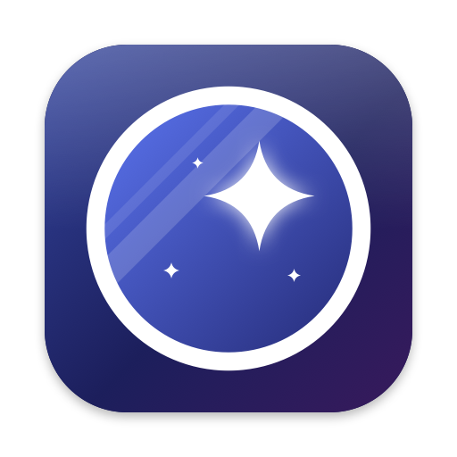
  <h1>Kamira</h1>
  <p>Catch the screen, keep it light.</p>
  <p><sub>The name joins <i>Kagami</i>, the sacred mirror of Japanese myth, with <i>Mira</i>, the star whose name is Latin for “wonderful”: a mirror that keeps the moment on screen as you saw it.</sub></p>
  <p>English · <a href="README_CN.md">简体中文</a></p>
  <p>
    <a href="https://github.com/okayzk/Kamira/releases/latest">Download</a> ·
    <a href="#highlights">Highlights</a> ·
    <a href="#features">Features</a> ·
    <a href="#faq">FAQ</a>
  </p>
  <a href="https://github.com/okayzk/Kamira/releases"></a>
  
  
  <a href="LICENSE"></a>
</div>

<p align="center">
  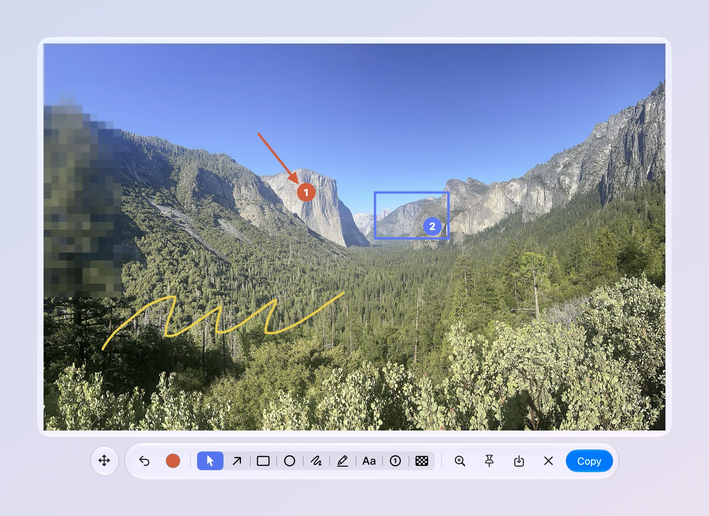
</p>

## Why

Kamira began as my own lighter alternative to [CleanShot X](https://cleanshot.com): keep what I love about it—the floating preview, pins, and a good-looking interface—and leave out everything beyond taking screenshots, so an app that is always running stays small.

## Highlights

**1. It captures the screen and leaves the rest to tools that do it better.**

- **Capture history**: every screenshot goes to the clipboard, so a clipboard manager can keep the history.
- **Cloud upload**: use the cloud drive or image host you already have, and drag the preview card straight into it.
- **Video editing and heavy image editing**: a recording's card opens it in your default app, such as QuickTime Player, for trimming. Annotation covers everyday marks like arrows, text, and pixelation.
- **Specialist text recognition**: formulas and similar specialist needs belong to dedicated apps. Kamira reads everyday Chinese and English.
- **Background styling, translation, and colour picking**: also left out.

**2. Where macOS already has a tool, Kamira uses it.**

- Rather than rebuilding screenshots, Kamira has the Mac's own `screencapture` take them, so selecting an area, pressing Space for a window, and Esc to cancel work exactly as they do in macOS. There’s nothing new to learn.
- Recording is handed to the system, which writes the file itself (ScreenCaptureKit's `SCRecordingOutput`), instead of passing every frame through the app to be encoded.
- Recordings play in Quick Look instead of a player of its own.

**3. Light, and it stays light.** On top of the two points above, the memory-hungry tasks—annotation, GIF conversion, and text recognition—run in separate helper processes that quit when finished, handing their memory back to the system. The result: about 20 MB in the background, about 110 MB and 2 % CPU while recording, and still 43 MB after a round of every feature, against 288–416 MB for CleanShot X (see [Measured](#measured)). The cost is a moment's start-up for those tasks: each is ready within 0.4 seconds, and some take about 0.1 seconds longer than in CleanShot X.

**4. Local processing, private captures.** Screenshots, recordings, and text recognition are processed on your Mac. Your screenshots and recordings are not uploaded. No account is required, and no usage data is collected. Network access is used only to check for and download updates from GitHub; automatic updates can be turned off.

**5. At home on your Mac.** The macOS 26 Liquid Glass appearance, system icons, and familiar panels fit naturally alongside your other Mac apps.

**6. Accessible, and easy for AI agents to drive.** VoiceOver reads the name of every control, and every control carries a fixed identifier, so Voice Control, automation tools, and AI agents can find and press it.

## Quick start

Requires **macOS 26 or later**. Supports Apple silicon and Intel Macs.

1. [Download the latest release](https://github.com/okayzk/Kamira/releases/latest), open `Kamira.dmg`, and drag the app into Applications.
2. On first launch, the welcome window brings screen recording permission, shortcuts, Open at Login and automatic updates together for setup. Reopen it at any time from **Settings → About → Show Welcome Window**.
3. Allow screen recording from the welcome window, follow the system prompt to **System Settings → Privacy & Security → Screen & System Audio Recording**, then reopen the app after granting permission.
4. The default shortcuts are ⇧⌘3, ⇧⌘4, and ⇧⌘5. Follow the welcome window's instructions to disable the matching system shortcuts, or record different keys there. You can change them later in **Settings → Shortcuts**. Use the menu bar icon or a shortcut to take your first capture.

<details>
<summary><b>First launch: "Apple could not verify…"</b></summary>

Releases are not yet notarized by Apple. If macOS blocks the first launch, go to **System Settings → Privacy & Security** and click **Open Anyway**. Alternatively, run this in Terminal:

```bash
xattr -dr com.apple.quarantine "/Applications/Kamira.app"
```
</details>

## Features

<table>
<tr>
  <td colspan="2" align="center">
    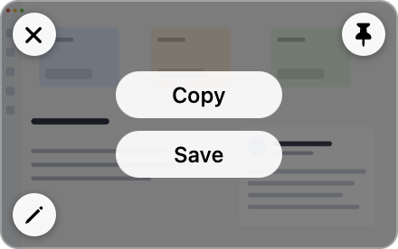<br/>
    <sub><b>Floating preview</b><br/>After a screenshot, a preview card appears in the corner. Copy, save, pin, annotate, or drag it into another app.</sub>
  </td>
</tr>
<tr>
  <td colspan="2" align="center">
    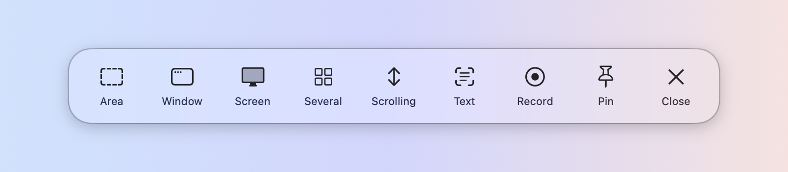<br/>
    <sub><b>Quick Panel (All in One)</b><br/>⇧⌘5 brings up every action in one bar.</sub>
  </td>
</tr>
</table>

- **Screenshots**: capture an area, a window, or the whole screen and copy it automatically to the clipboard. Optionally save captures to a folder of your choice with custom file naming. Capture several in a row and press Esc to get them as one picture.
- **Floating preview**: screenshots and recordings appear as preview cards, with an optional auto-dismiss timer. Several cards stack into a single pile with only the newest in full view, and spread out when you move the pointer over them, so a run of screenshots never takes over the screen the way it can in CleanShot X.
- **Pins**: keep a screenshot above other windows for reference. It becomes translucent when you move the pointer over it.
- **Annotation**: add arrows, lines, shapes, freehand strokes, highlights, text, numbered markers, and pixelation. Hold Shift for level lines, squares, and circles. Zoom in to edit fine details, or crop. Several screenshots can be dragged apart, restacked and set on a background of your choice, and another can be added from the editor. Return copies.
- **Scrolling capture**: select a region and scroll manually to stitch a long image with a live preview. Overlapping content in consecutive frames is matched while fixed headers, sidebars, and similar elements are excluded from matching. Stitching has been verified on a test page with translucent Liquid Glass overlays.
- **Text recognition (OCR)**: select an area to recognise and copy Chinese and English text entirely on your Mac, with no network connection needed. Text from multiple columns on the same line stays together, useful for tables and code.
- **Recording**: record an area, a window, or the whole screen as video or GIF, with microphone and system audio available for video recordings.
- **Settings**: customise shortcuts, save locations, and preview behaviour. Launch at login or hide desktop icons during screenshots and recordings.
- **Automatic updates**: at the bottom of **Settings → General**, choose Never, Check and Ask to Install, or Install Automatically. Automatic checks can run daily, weekly or monthly. The **Check for Updates…** button below is always available, including when automatic updates are set to Never.

## Shortcuts

| Action | Shortcut |
|---|---|
| Capture the whole screen (also selects it when recording) | `⇧⌘3` |
| Capture an area | `⇧⌘4` |
| Quick Panel | `⇧⌘5` |
| Switch between area and window while selecting | `Space` (for recording, Space cannot switch back to an area after switching to a window) |
| Start recording a video / a GIF | `↩` / `⌥↩` |

The first three are global shortcuts, and each action's can be changed under **Settings → Shortcuts**. By default they are the same keys as the system's screenshot shortcuts: while those are on, the keys go to the system only.

## How it compares

The following tables compare Kamira with macOS Screenshot, [CleanShot X](https://cleanshot.com) 5.0.2, and the open-source apps [Snow Shot](https://github.com/mg-chao/snow-shot) 1.5.7, [Snapzy](https://github.com/duongductrong/Snapzy) 2.1.0, and [capcap](https://github.com/realskyrin/capcap) 1.7.25. Results apply to these versions under the test conditions described below.

### Feature comparison

| | Kamira | macOS Screenshot | CleanShot X | Snow Shot | Snapzy | capcap |
|---|---|---|---|---|---|---|
| Price | free | built in | paid | free | free | free |
| Open source | ✓ | — | — | ✓ | ✓ | ✓ |
| Editable annotations | ✓ | Markup | ✓ | ✓ | ✓ | ✓ |
| Pins | ✓ | — | ✓ | ✓ | ✓ | ✓ |
| Scrolling capture | ✓ | — | ✓ | ✓ | ✓ | ✓ |
| Text recognition | ✓ | Live Text | ✓ | ✓ | ✓ | ✓ |
| Video and GIF recording | ✓ | video | ✓ | ✓ | ✓ | ✓ |
| History | — | — | ✓ | ✓ | ✓ | ✓ |
| Cloud upload | — | — | ✓ | ✓ | ✓ | ✓ |
| Requires | macOS 26 | — | — | macOS 15 | macOS 13 | macOS 14 |

<sub>From each product's own pages and source, November 2026.</sub>

### Measured

| | Kamira | macOS Screenshot | CleanShot X | Snow Shot | Snapzy | capcap |
|---|---|---|---|---|---|---|
| Memory, idle | 23 MB | — | 83–90 MB | 69 MB | 55 MB | 54 MB |
| Memory while recording | 110 MB | 10 MB¹ | 192–436 MB | 582 MB | 512 MB | 357 MB |
| Memory after all tests | 43 MB | — | 288–416 MB | 565 MB | 354 MB | 261 MB |
| CPU while recording | 2 % | 0.2 %¹ | 12 % | 22 % | 36 % | 7 % |
| OCR character match rate | 98.9 % | — | 98.9 % | 100 % | 98.9 % | 98.9 % |
| Scrolling capture: repetitive rows | ✓ | — | automatic ✗ | automatic ✗ | automatic ✗ | ✗ |
| Scrolling capture: fixed bars and Liquid Glass overlays | ✓ | — | ✓ | ✓ | ✓ | ✗ |
| Recording, file size per minute | 45 MB | 49 MB | 103 MB | 6 MB² | 50 MB | 61 MB |

Tested on 14 November 2026 on an Apple M3 MacBook Air with 16 GB, running macOS 27.2. Each app ran separately. See below for methods and result notes.

<details>
<summary><b>Test methods and result notes</b></summary>

Most test actions used scripted mouse, keyboard, and scroll input. The developer performed the few actions that did not accept simulated input manually.

**Memory**

Memory is the footprint shown by Activity Monitor, summed across the app and its associated processes. Idle measurements were taken one minute after launch with no windows open. Memory after all tests was measured one minute after completing every test.

¹ For macOS recording, only the `screencapture` process was counted. Encoding happens in other system processes, so the measurement scope differs from the other apps.

**Text recognition**

The six lines shown below mix English, Chinese, and code, with 177 non-whitespace characters in total. Each reference line is matched to the closest recognised line. The match rate is calculated from character substitutions, deletions, and insertions, ignoring whitespace and line order. For this sample, 98.9% corresponds to two character edits; 100% means all characters match.

<p align="center">
  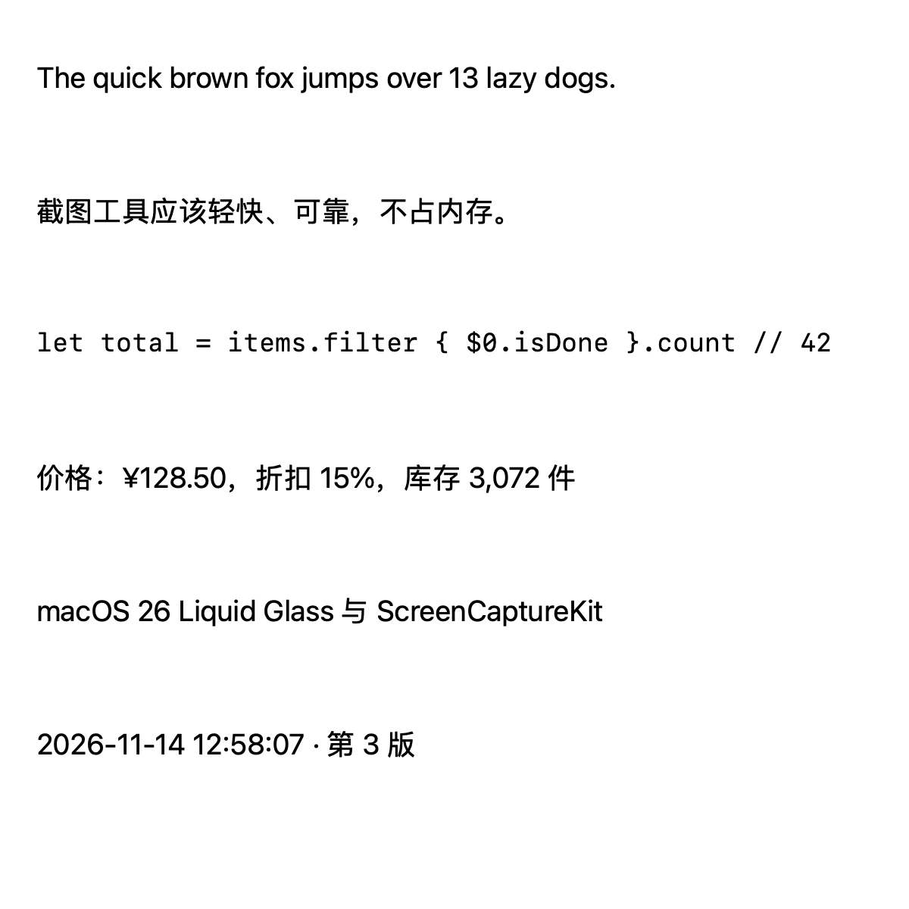<br/>
  <sub>Original text recognition test image</sub>
</p>

**Scrolling capture**

The 600 × 600 pt test window contains numbered rows, a fixed header, footer, and sidebar, and translucent Liquid Glass overlays. The tests check repetitive-row stitching and the handling of fixed elements and overlays. A pass requires consecutive row numbers within the captured range, with no missing or duplicate rows, and each fixed element and overlay appearing once. Apps supporting automatic scrolling were tested in that mode.

<p align="center">
  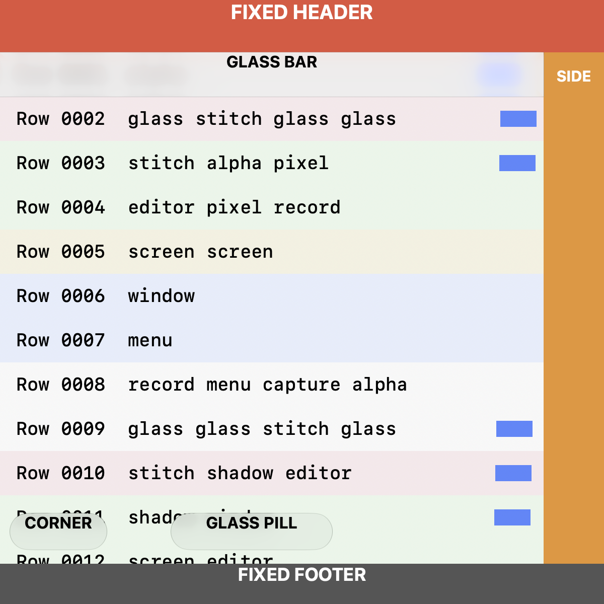<br/>
  <sub>Fixed bars and Liquid Glass overlays: a single screen, not a stitched result</sub>
</p>

<p align="center">
  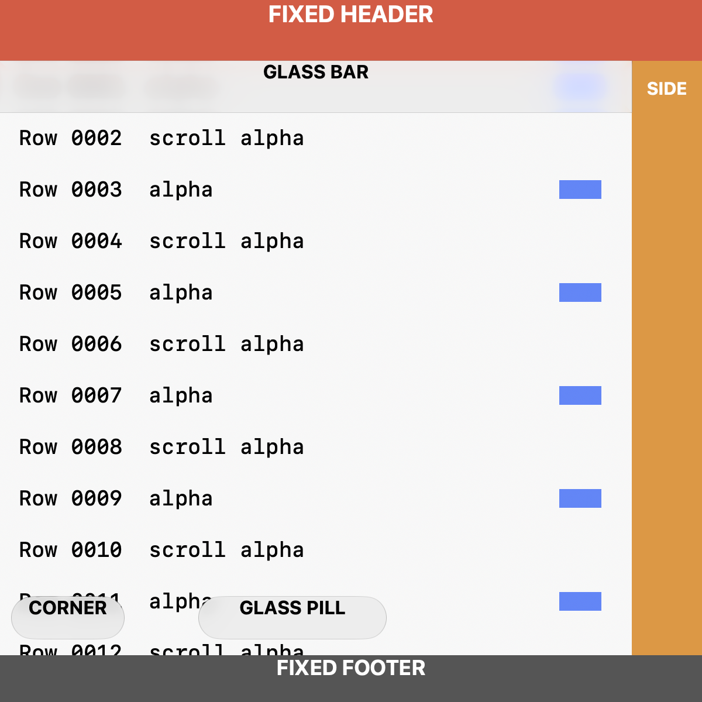<br/>
  <sub>Repetitive rows: a single screen, not a stitched result</sub>
</p>

**Kamira: successful results**

These are the actual outputs from both tests, using manual scrolling. Numbered rows 0002–0065 within the captured range appear continuously, without missing, duplicate, or out-of-order rows. Fixed bars and glass overlays appear once each. Click an image to view the full original.

<table>
<tr>
  <td width="50%" align="center" valign="top">
    <a href="assets/benchmark-repeat-kamira.webp">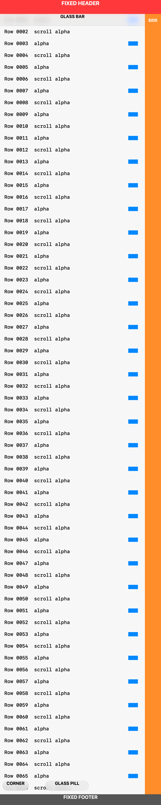</a><br/>
    <sub><b>Repetitive rows</b><br/>Similar content stitched continuously, with row numbers in order.</sub>
  </td>
  <td width="50%" align="center" valign="top">
    <a href="assets/benchmark-glass-kamira.webp">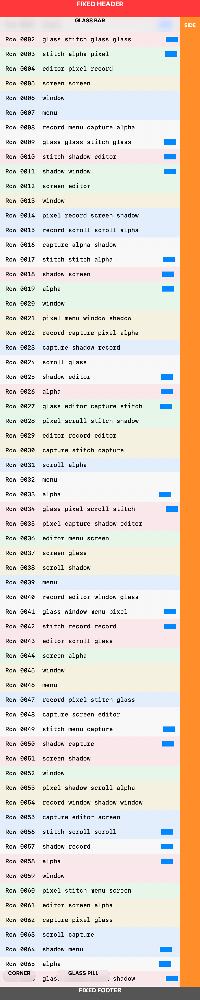</a><br/>
    <sub><b>Fixed bars and Liquid Glass overlays</b><br/>Continuous content, with no repeated fixed bars or translucent overlays.</sub>
  </td>
</tr>
</table>

**Automatic scrolling on repetitive rows: failed results**

These images document automatic scrolling tests on the repetitive-row page using the versions listed above. Click an image to view the original.

<table>
<tr>
  <td width="50%" align="center" valign="top">
    <a href="assets/benchmark-repeat-cleanshot.webp">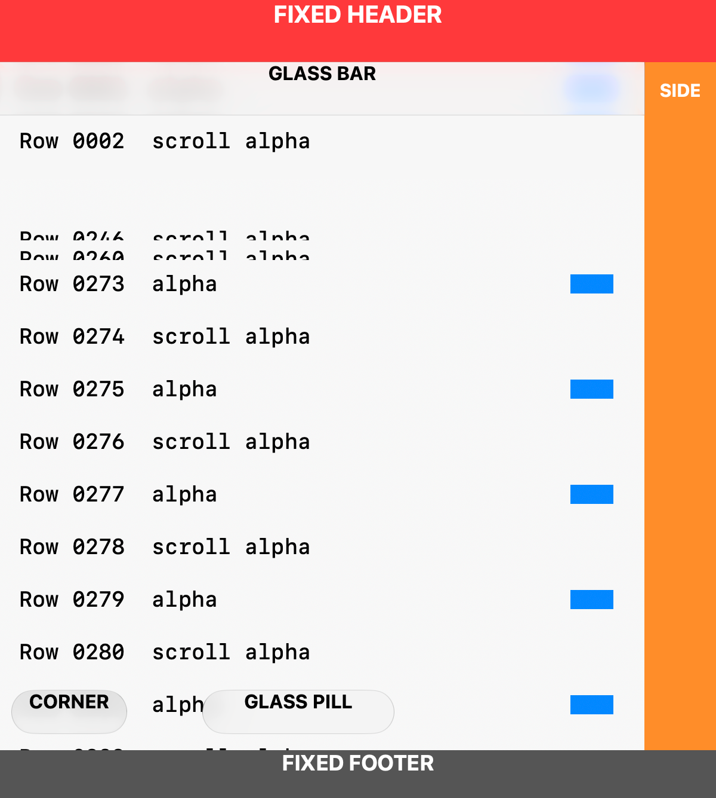</a><br/>
    <sub><b>CleanShot X 5.0.2</b><br/>Actual output: many rows skipped, with some text clipped.</sub>
  </td>
  <td width="50%" align="center" valign="top">
    <a href="assets/benchmark-repeat-snow-shot.webp">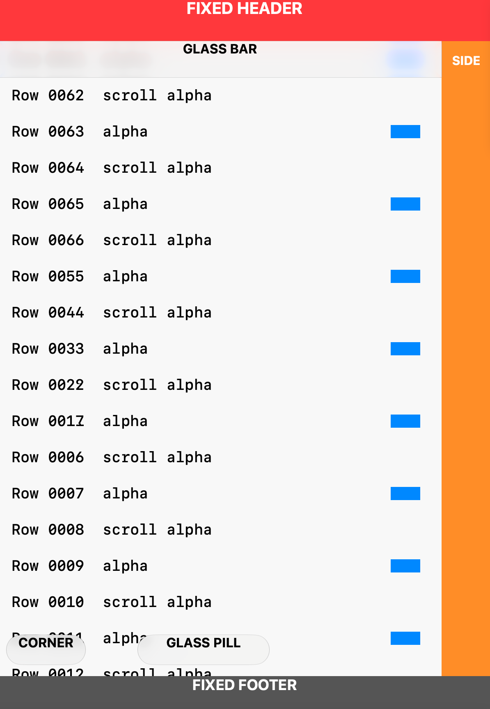</a><br/>
    <sub><b>Snow Shot 1.5.7</b><br/>Actual output: rows out of order and some text overlapping.</sub>
  </td>
</tr>
<tr>
  <td width="50%" align="center" valign="top">
    <a href="assets/benchmark-repeat-snapzy.webp">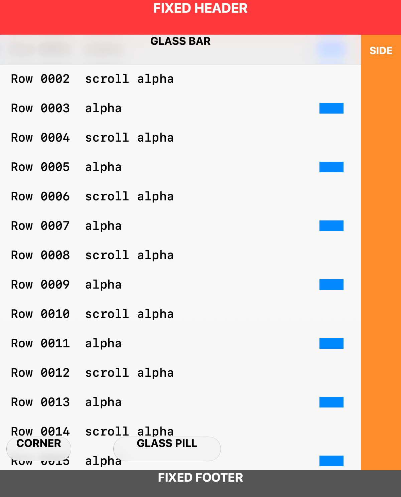</a><br/>
    <sub><b>Snapzy 2.1.0</b><br/>Actual output: stopped early without capturing the full page.</sub>
  </td>
  <td width="50%" align="center" valign="top">
    <a href="assets/benchmark-repeat-capcap-ui.webp">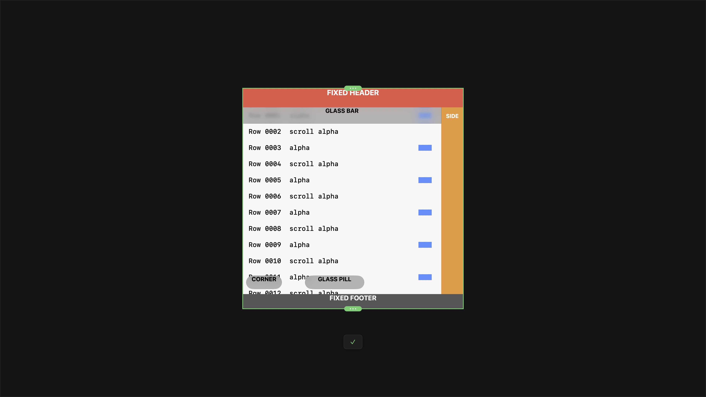</a><br/>
    <sub><b>capcap 1.7.25</b><br/>Failure screenshot: automatic mode finished with only the first screen visible; no complete long capture was obtained. This shows the result interface, not an exported image.</sub>
  </td>
</tr>
</table>

**Recording**

Recordings used a 600 × 600 pt region changing 30 times per second, with each app at its default settings.

² Snow Shot outputs at 1086 × 1080 with heavier compression, so file sizes do not reflect performance at equal visual quality.

</details>

## FAQ

- **Does it support cloud sharing or a capture history?** Neither, by design: see [Highlights](#highlights) for the reasons and what to use instead.
- **Why macOS 26 or later?** The interface is made of Liquid Glass, which older systems do not have. This is a deliberate trade: one modern code path instead of several.
- **Which recording options can I customise?** Choose an area, a window, or the whole screen; toggle the microphone, system audio, and start countdown; and record video or GIF. You can also set the save folder, file naming, a maximum size at which recording stops by itself, and floating previews. Resolution, frame rate, and bitrate controls are intentionally omitted. GIFs have no audio.
- **Where are screenshots and recordings saved?** Screenshots are copied to the clipboard by default. In **Settings**, you can enable automatic saving and choose a folder. Recordings are always written straight into that folder as they are recorded; closing the floating preview never deletes one, and its Save As makes a copy elsewhere.
- **The interface is in the wrong language.** It follows the system language. To choose for this app only: System Settings → Language & Region → Applications.
- **I hid the menu bar icon. How do I get it back?** Open Kamira again from Finder, Spotlight or Launchpad: the icon and the settings window appear.
- **Does it work on Intel Macs?** The release contains an Intel build, but it has only been run on Apple silicon so far. Reports are welcome.

## Build from source

Needs macOS 26 and the Apple command-line tools. No dependencies to fetch.

```bash
git clone https://github.com/okayzk/Kamira.git
cd Kamira
make build && open build/Kamira.app
make check        # tests and gates
```

## License

Copyright (c) 2026 okayzk. Released under the MIT License. See [LICENSE](LICENSE).
