<div align="center">
  
  <h1>Kamira</h1>
  <p>截得下，放得轻。</p>
  <p><sub>名字取自日本神话里的神镜 <i>Kagami</i> 和鲸鱼座的变星 <i>Mira</i>（拉丁语意为“奇妙”）：像一面镜子，把屏幕上的那一刻原样留住。</sub></p>
  <p><a href="README.md">English</a> · 简体中文</p>
  <p>
    <a href="https://github.com/okayzk/Kamira/releases/latest">下载</a> ·
    <a href="#功能">功能</a> ·
    <a href="#常见问题">常见问题</a>
  </p>
  <a href="https://github.com/okayzk/Kamira/releases"></a>
  
  <a href="LICENSE"></a>
</div>

<p align="center">
  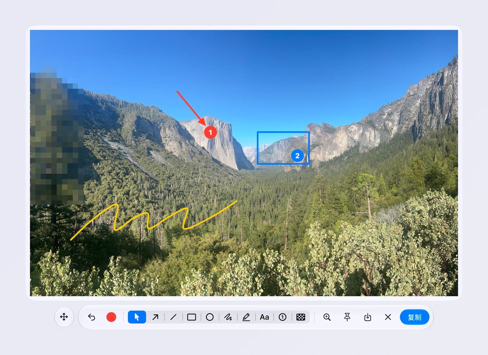
</p>

## 缘起

macOS 自带的截图和录屏已经很好用。我们想保留熟悉的截图操作，补上贴图、长截图、文字识别等日常功能，同时让这个常驻后台的小工具尽量少占内存。

## 特点

**一、熟悉的截图操作。** 沿用 Mac 自带的截图框选，按空格切换窗口截图，按 Esc 取消，无需重新适应。

**二、少占内存。** 平时在后台运行只占约 20 MB 内存。标注、转 GIF、识别文字等更吃内存的操作，会交给独立的子进程；用完就退出，把内存还给系统。

**三、本地处理，保护隐私。** 截图、录屏和文字识别都在本机完成，不上传截图或录屏内容，无需注册，也不收集使用数据。联网仅用于检查和下载 GitHub 上的更新，可以关闭。

**四、融入 Mac 的界面。** 采用 macOS 26 的液态玻璃外观，搭配系统图标和面板，与你熟悉的 Mac 应用保持一致。

## 快速上手

需要 **macOS 26 或更新版本**，支持 Apple 芯片和 Intel Mac。

1. [下载最新版本](https://github.com/okayzk/Kamira/releases/latest)，打开 `Kamira.dmg`，将应用拖入“应用程序”文件夹。
2. 首次打开会出现欢迎页，统一设置录屏权限、快捷键、登录时打开和更新方式；之后也可从 **设置 → 关于 → 显示欢迎页** 再次打开。
3. 在欢迎页允许录屏，按系统提示前往 **系统设置 → 隐私与安全性 → 录屏与系统录音** 授权，然后重新打开应用。
4. 默认快捷键为 ⇧⌘3、⇧⌘4、⇧⌘5。按欢迎页提示关闭系统的同名快捷键，或直接改用其他组合；之后也能在 **设置 → 快捷键** 中修改。完成后，点击菜单栏图标或按快捷键开始截图。

<details>
<summary><b>首次打开提示“Apple 无法验证……”</b></summary>

目前的版本尚未经过 Apple 公证。首次打开若被拦截，请前往 **系统设置 → 隐私与安全性**，点击 **仍要打开**。也可以在终端执行：

```bash
xattr -dr com.apple.quarantine "/Applications/Kamira.app"
```
</details>

## 功能

<table>
<tr>
  <td colspan="2" align="center">
    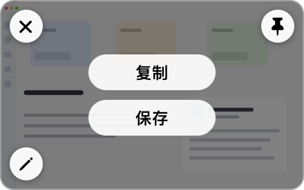<br/>
    <sub><b>悬浮预览</b><br/>截图后，角落会出现预览卡片，可复制、保存、贴图、标注，或直接拖入其他应用。</sub>
  </td>
</tr>
<tr>
  <td colspan="2" align="center">
    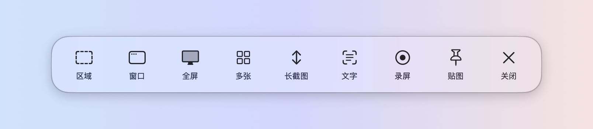<br/>
    <sub><b>快捷面板（All in One）</b><br/>按 ⇧⌘5，所有操作排成一行。</sub>
  </td>
</tr>
</table>

- **截图**：支持区域、窗口和全屏截图，自动复制到剪贴板，也可自动保存到指定文件夹。支持自定义文件名。
- **悬浮预览**：截图和录屏后显示预览卡片，可设置自动消失时间。
- **贴图**：将截图置顶，方便对照其他窗口；鼠标移上去时自动变为半透明。
- **标注**：支持箭头、形状、画笔、高亮、文字、序号和马赛克，可放大图片编辑细节。
- **滚动长截图**：框选区域后手动滚动，自动拼接并实时预览。通过匹配相邻画面的重叠区域完成拼接，排除固定页眉、侧栏等元素的干扰；已在带有液态玻璃半透明浮层的测试页面中验证拼接效果。
- **识别文字（OCR）**：在本机识别中英文，框选即可复制，全程无需联网。保留同一行的多列文字，方便处理表格和代码。
- **录屏**：支持区域、窗口和全屏录制，可录制麦克风及系统声音，保存为视频或 GIF。
- **无障碍**：旁白能读出每个按钮的名称。预览卡片和贴图上那些鼠标移上去才出现的按钮，也能直接用旁白操作；提示信息会自动播报。语音控制和自动化工具可以凭固定标识找到每个控件。
- **设置**：自定义快捷键、保存位置和预览行为，支持登录时打开，以及截图、录屏时隐藏桌面图标。
- **自动更新**：在 **设置 → 通用** 底部选择从不、检查后询问或自动下载并安装；检查频率可设为每天、每周或每月。下方的 **检查更新…** 按钮始终可用，选了“从不”也能手动检查。

## 快捷键

| 操作 | 快捷键 |
|---|---|
| 截取全屏（录屏时则是选中全屏） | `⇧⌘3` |
| 截取区域 | `⇧⌘4` |
| 快捷面板 | `⇧⌘5` |
| 框选时在区域和窗口之间切换 | `空格`（录屏时切换到窗口后，无法用空格切回区域） |
| 开始录制视频 / GIF | `↩` / `⌥↩` |

前三个是全局快捷键，每个操作的都能在 **设置 → 快捷键** 里改。它们默认和系统截屏的相同：系统的那几个开着时，按键只会交给系统。

## 横向对比

以下对比 macOS 自带截图、[CleanShot X](https://cleanshot.com) 5.0.2，以及开源软件 [Snow Shot](https://github.com/mg-chao/snow-shot) 1.5.7、[Snapzy](https://github.com/duongductrong/Snapzy) 2.1.0 和 [capcap](https://github.com/realskyrin/capcap) 1.7.25。测试结果仅反映所列版本在本次测试条件下的表现。

### 功能对比

| | Kamira | macOS 自带截图 | CleanShot X | Snow Shot | Snapzy | capcap |
|---|---|---|---|---|---|---|
| 价格 | 免费 | 系统自带 | 付费 | 免费 | 免费 | 免费 |
| 是否开源 | ✓ | — | — | ✓ | ✓ | ✓ |
| 可编辑标注 | ✓ | 标记 | ✓ | ✓ | ✓ | ✓ |
| 贴图 | ✓ | — | ✓ | ✓ | ✓ | ✓ |
| 滚动长截图 | ✓ | — | ✓ | ✓ | ✓ | ✓ |
| 识别文字 | ✓ | 实况文本 | ✓ | ✓ | ✓ | ✓ |
| 录制视频与 GIF | ✓ | 视频 | ✓ | ✓ | ✓ | ✓ |
| 历史记录 | — | — | ✓ | ✓ | ✓ | ✓ |
| 上传云端 | — | — | ✓ | ✓ | ✓ | ✓ |
| 系统要求 | macOS 26 | — | — | macOS 15 | macOS 13 | macOS 14 |

<sub>依据各产品 2026 年 11 月的官方页面和源代码。</sub>

### 实测

| | Kamira | macOS 自带截图 | CleanShot X | Snow Shot | Snapzy | capcap |
|---|---|---|---|---|---|---|
| 空闲内存 | 23 MB | — | 83～90 MB | 69 MB | 55 MB | 54 MB |
| 录屏时内存 | 110 MB | 10 MB¹ | 192～436 MB | 582 MB | 512 MB | 357 MB |
| 完成所有测试项后内存 | 43 MB | — | 288～416 MB | 565 MB | 354 MB | 261 MB |
| 录屏时 CPU | 2% | 0.2%¹ | 12% | 22% | 36% | 7% |
| 文字识别字符匹配率 | 98.9% | — | 98.9% | 100% | 98.9% | 98.9% |
| 长截图：重复行 | ✓ | — | 自动 ✗ | 自动 ✗ | 自动 ✗ | ✗ |
| 长截图：固定栏与液态玻璃浮层 | ✓ | — | ✓ | ✓ | ✓ | ✗ |
| 录屏文件每分钟大小 | 45 MB | 49 MB | 103 MB | 6 MB² | 50 MB | 61 MB |

测试于 2026 年 11 月 14 日，设备为 Apple M3 MacBook Air（16 GB），系统为 macOS 27.2。各软件单独运行，详细条件和结果说明见下方。

<details>
<summary><b>测试方法与结果说明</b></summary>

大部分测试操作由脚本模拟鼠标、键盘和滚动完成，少数不接受模拟的操作由开发者手动完成。

**内存**

内存取“活动监视器”显示的占用，合计软件及其带起的所有进程。“空闲”为启动一分钟后、没有任何窗口时；“完成所有测试项后内存”为完成所有测试项，再等待一分钟后测得的内存占用。

¹ macOS 自带录屏只统计了 `screencapture` 进程，编码由系统在其他进程中完成，因此统计范围与其他软件不同。

**文字识别**

测试内容为图中的六行中英文与代码，共 177 个非空白字符。逐行寻找最接近的识别结果，按字符替换、遗漏和多出的次数计算匹配率，忽略空白字符和行顺序。本次 98.9% 对应两处字符差异，100% 表示全部字符匹配。

<p align="center">
  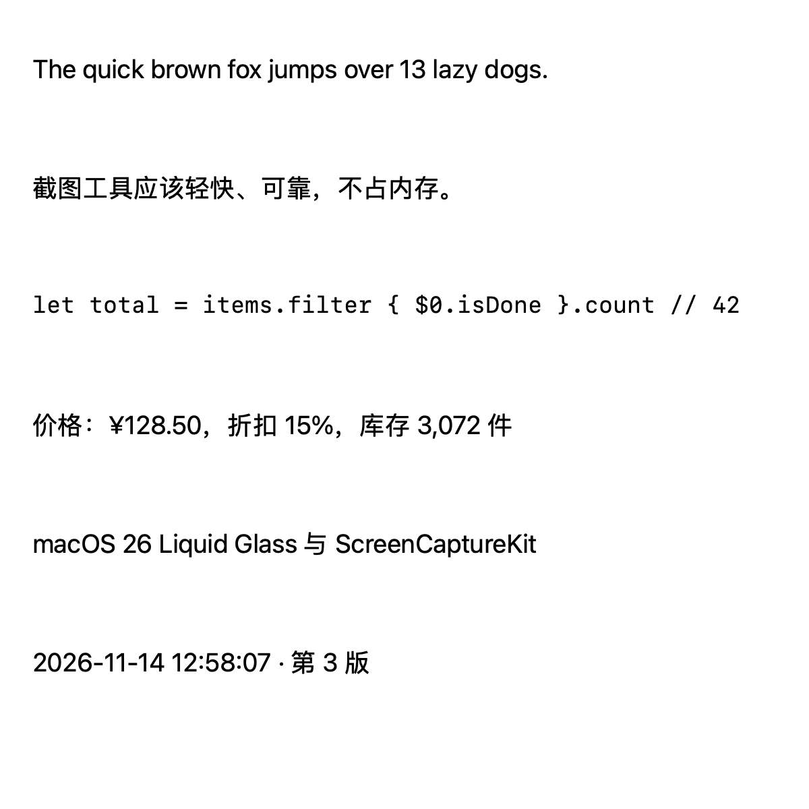<br/>
  <sub>文字识别测试原图</sub>
</p>

**长截图**

测试窗口为 600 × 600 点，包含编号行、固定顶栏、底栏、侧栏及液态玻璃半透明浮层。分别检查重复行的拼接，以及固定元素和浮层的处理。通过标准为：捕获范围内的行号连续、无遗漏或重复，固定元素与浮层各保留一次。支持自动滚动的软件使用自动模式。

<p align="center">
  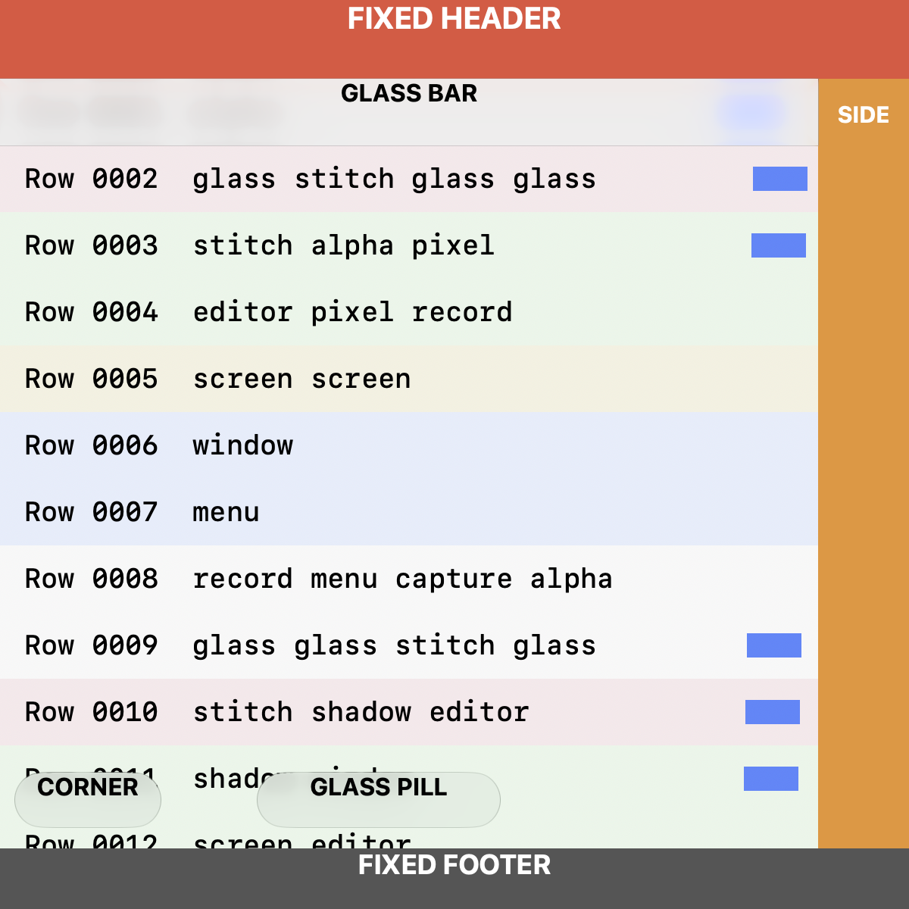<br/>
  <sub>固定栏与液态玻璃浮层测试：单屏画面，并非拼接结果</sub>
</p>

<p align="center">
  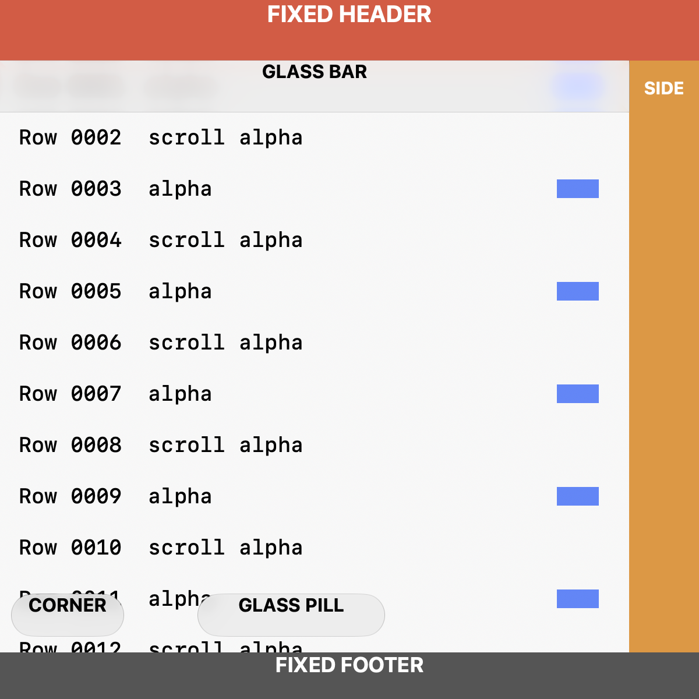<br/>
  <sub>重复行测试：单屏画面，并非拼接结果</sub>
</p>

**Kamira：成功结果**

以下为两项测试的实际输出，均采用手动滚动。捕获范围内的编号行 0002–0065 连续出现，没有缺行、重复或乱序，固定栏与玻璃浮层各保留一次。点击图片可查看完整原图。

<table>
<tr>
  <td width="50%" align="center" valign="top">
    <a href="assets/benchmark-repeat-kamira.webp">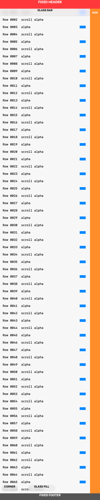</a><br/>
    <sub><b>重复行测试</b><br/>相似内容连续拼接，行号顺序完整。</sub>
  </td>
  <td width="50%" align="center" valign="top">
    <a href="assets/benchmark-glass-kamira.webp">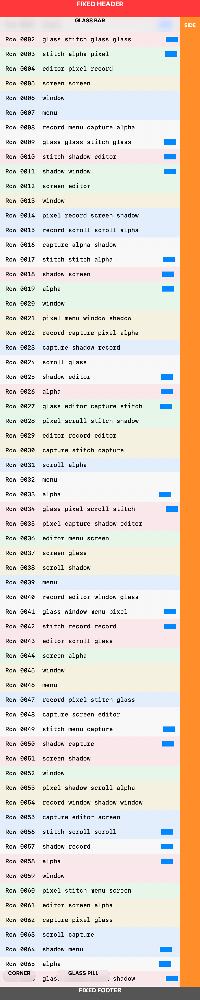</a><br/>
    <sub><b>固定栏与液态玻璃浮层测试</b><br/>正文连续，固定栏与半透明浮层不重复。</sub>
  </td>
</tr>
</table>

**重复行自动长截图：失败结果**

以下图片来自上述版本在重复行测试页面中的自动长截图。点击图片可查看原图。

<table>
<tr>
  <td width="50%" align="center" valign="top">
    <a href="assets/benchmark-repeat-cleanshot.webp">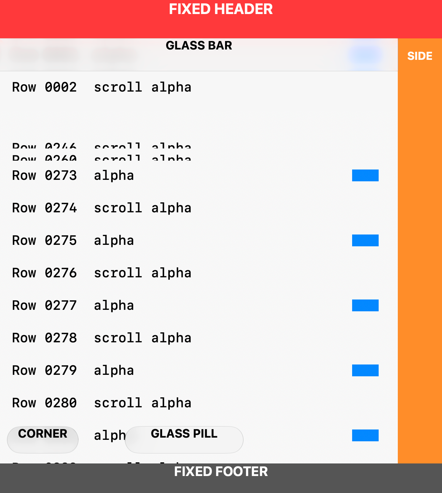</a><br/>
    <sub><b>CleanShot X 5.0.2</b><br/>实际输出：跳过大量行，部分文字被截断。</sub>
  </td>
  <td width="50%" align="center" valign="top">
    <a href="assets/benchmark-repeat-snow-shot.webp">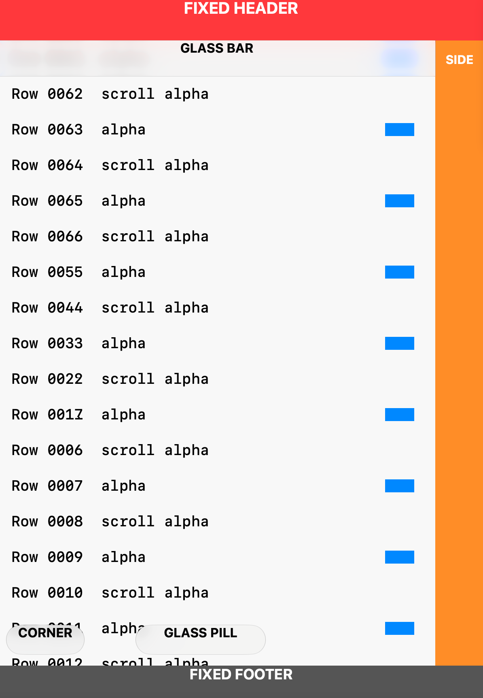</a><br/>
    <sub><b>Snow Shot 1.5.7</b><br/>实际输出：行顺序错乱，部分文字重叠。</sub>
  </td>
</tr>
<tr>
  <td width="50%" align="center" valign="top">
    <a href="assets/benchmark-repeat-snapzy.webp">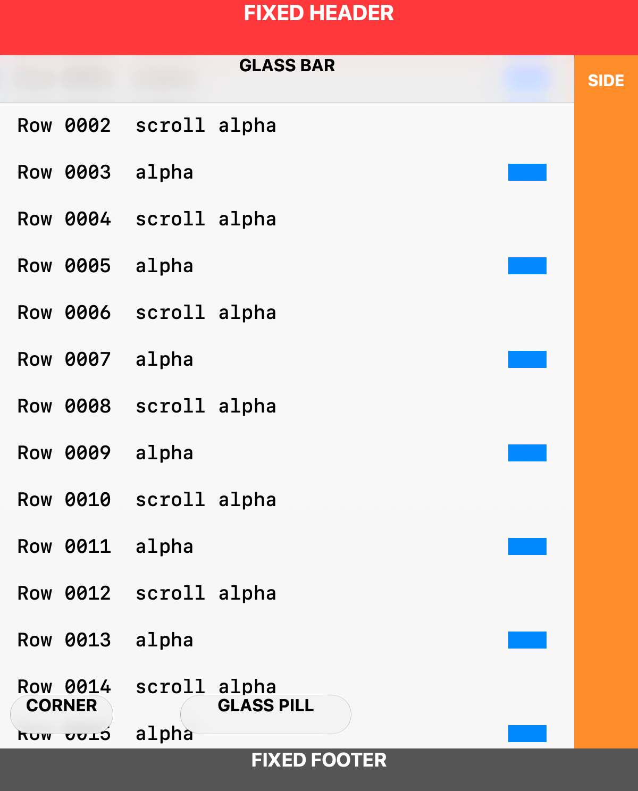</a><br/>
    <sub><b>Snapzy 2.1.0</b><br/>实际输出：提前结束，未截完整页面。</sub>
  </td>
  <td width="50%" align="center" valign="top">
    <a href="assets/benchmark-repeat-capcap-ui.webp">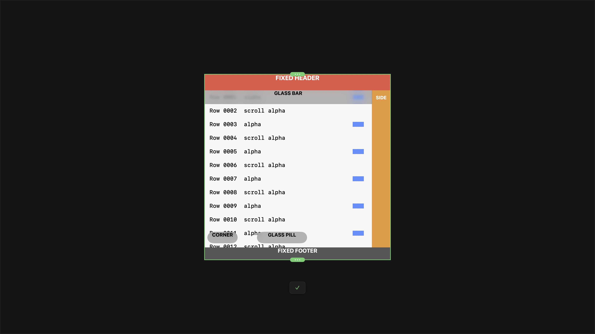</a><br/>
    <sub><b>capcap 1.7.25</b><br/>失败现场：自动模式结束后仅显示第一屏，未取得完整长图。此图为结果界面截图，并非导出图像。</sub>
  </td>
</tr>
</table>

**录屏**

录制对象为每秒变化 30 次的 600 × 600 点区域，各软件使用默认设置。

² Snow Shot 的输出分辨率为 1086 × 1080，压缩程度也更高，文件大小不代表同等画质下的表现。

</details>

## 常见问题

- **支持云端分享或截图历史吗？** 刻意不支持，也不提供背景美化、翻译和屏幕取色。
- **为什么要求 macOS 26？** 界面是用液态玻璃做的，旧系统没有。这是有意的取舍：只维护一套现代的实现，而不是好几套。
- **录屏支持哪些自定义？** 可选择区域、窗口或全屏，开关麦克风、系统声音和开始倒计时，输出视频或 GIF；还可设置保存位置、文件名、录到多大自动停止，以及悬浮预览。刻意不提供分辨率、帧率或码率的自定义，GIF 不含声音。
- **截图和录屏保存在哪里？** 截图默认复制到剪贴板，也可在 **设置** 中开启自动保存、指定文件夹。录屏一边录一边直接存进这个文件夹；关闭悬浮预览不会删除录像，预览上的“另存为”可以再存一份到别处。
- **界面语言不对。** 它跟随系统语言。想单独给它指定语言：系统设置 → 语言与地区 → 应用程序。
- **菜单栏图标被我隐藏了，怎么找回来？** 从访达、聚焦或启动台再打开一次 Kamira，图标和设置窗口就都出来了。
- **Intel 的 Mac 能用吗？** 安装包里有 Intel 版本，但目前只在 Apple 芯片上实际跑过，欢迎反馈。

## 从源码构建

需要 macOS 26 和 Apple 的命令行开发工具，没有任何依赖要装。

```bash
git clone https://github.com/okayzk/Kamira.git
cd Kamira
make build && open build/Kamira.app
make check        # 测试与各项检查
```

## 许可

Copyright (c) 2026 okayzk。采用 GNU 通用公共许可证第 3 版（GPL-3.0-only），见 [LICENSE](LICENSE)。
